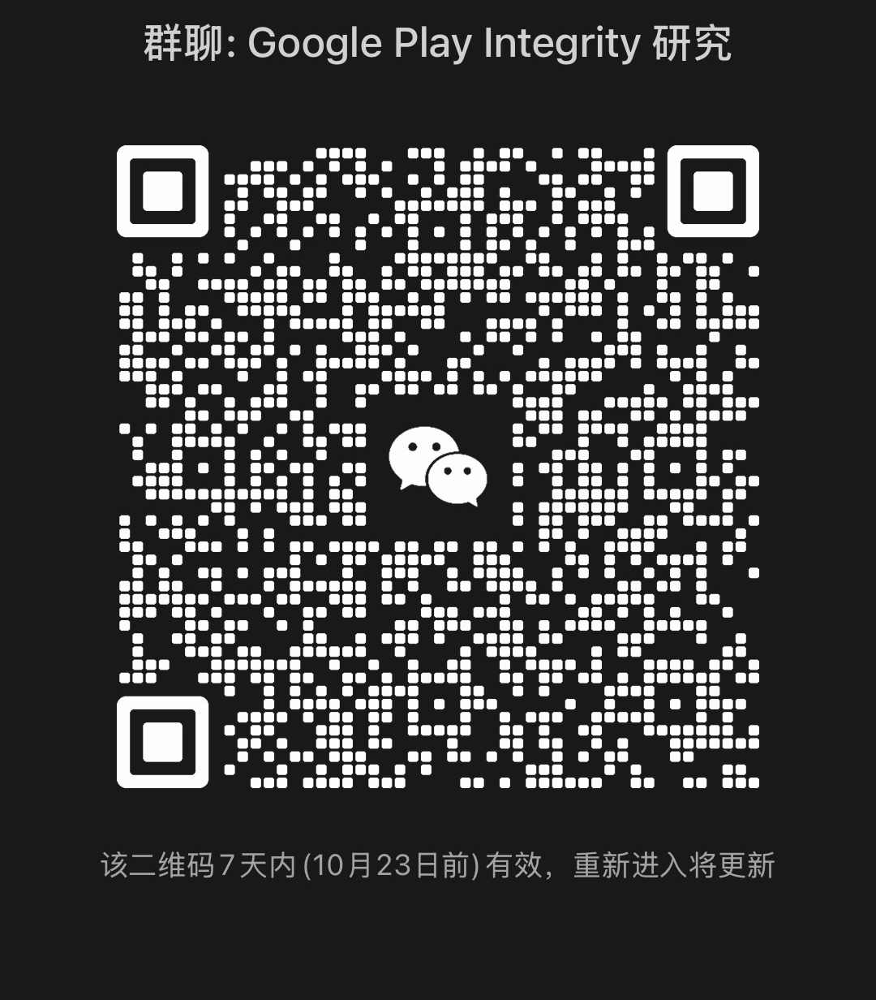
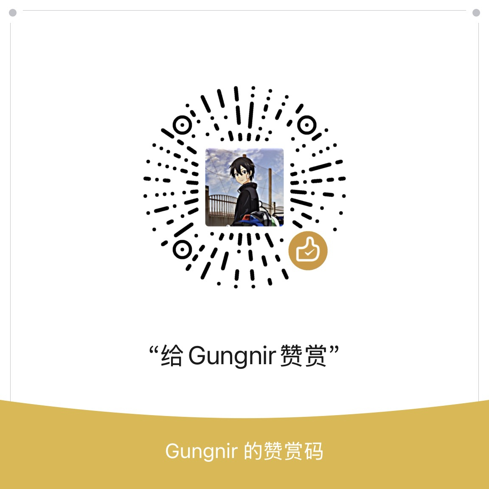
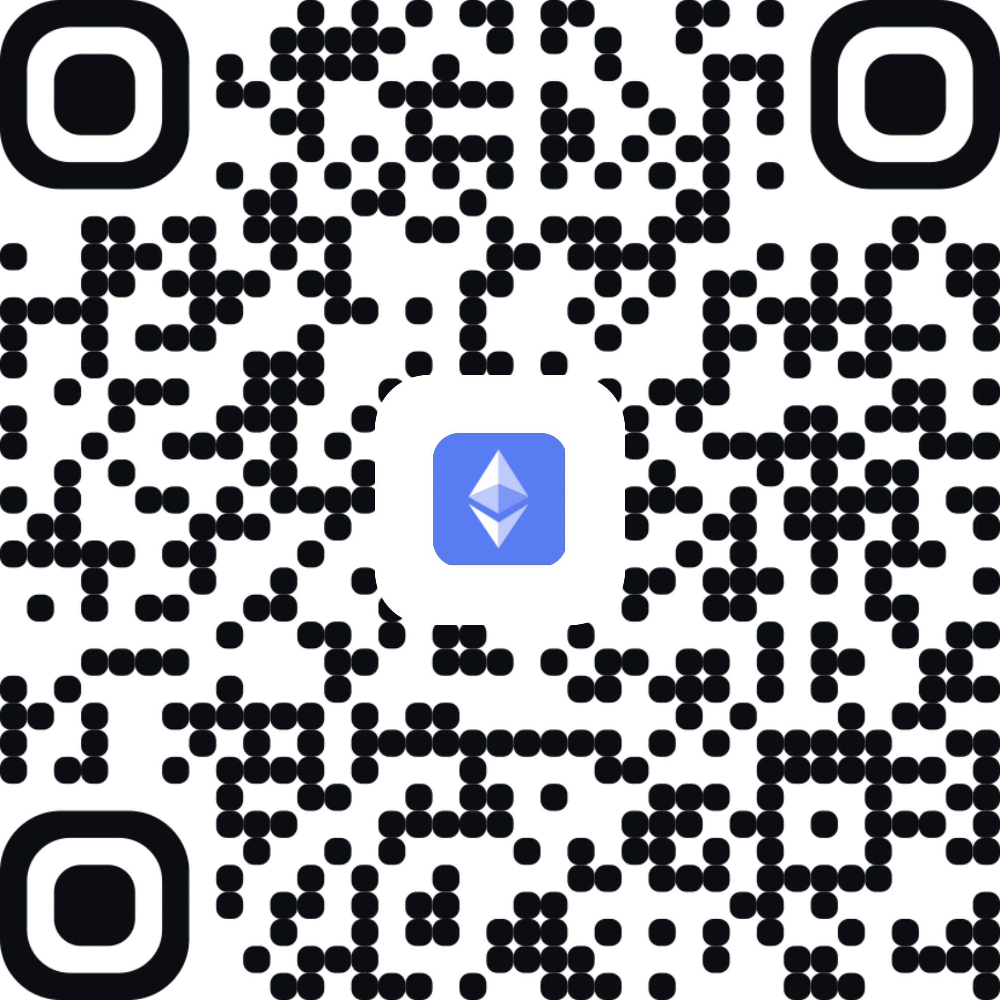
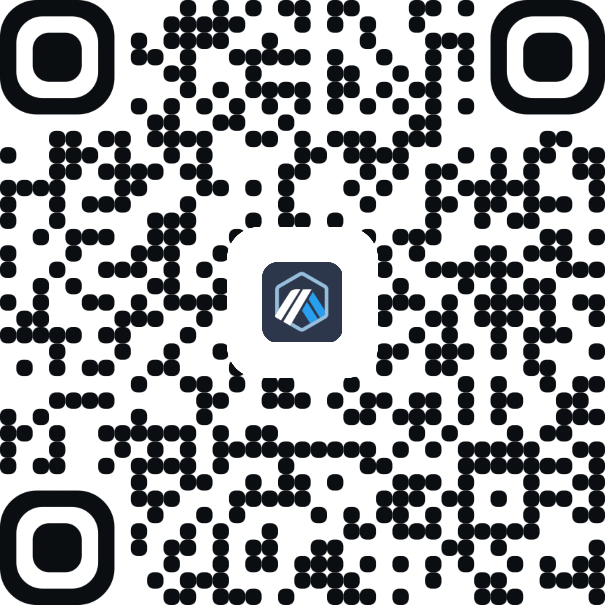
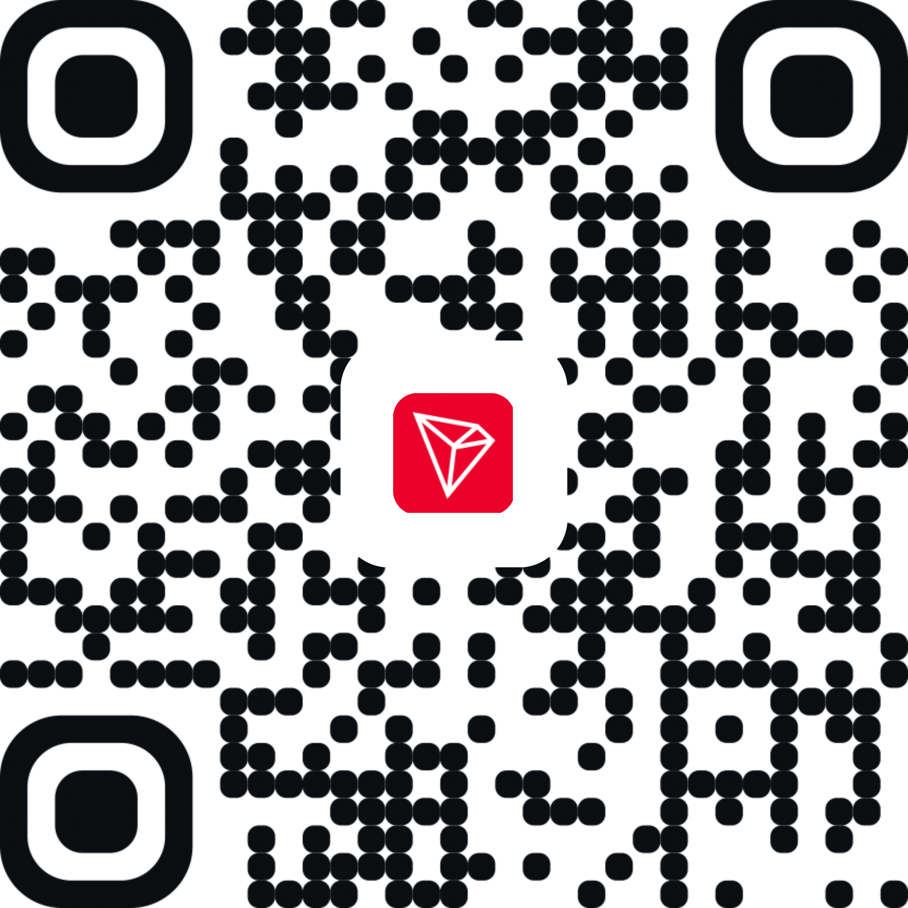

# Android TEE Keybox 与 RKP 研究资料

中文 | [English](README_en.md)

当前 `main` 分支收录三台设备的技术研究复盘，仅提供原理、验证关系与经整理的研究记录。原始设备转储、证书私钥、seed 原值、补丁二进制、厂商固件和可直接运行的提取脚本均未纳入当前分支。

文档由 AI 阅读来源工程后整理，未经人工逐条重新复现。研究结果应按证据链单独核对；文字不能替代授权、固件版本检查或安全操作判断。

## 设备文档

| 设备 | 已记录成果 | 中文 | English |
|---|---|---|---|
| Nothing 2a | Keybox 与 RKP 派生材料研究 | [教程](01_Nothing2A_RKP种子_Keybox/01_教程/教程_zh-CN.md) · [流水](01_Nothing2A_RKP种子_Keybox/02_流水记录/流水记录_zh-CN.md) · [原理](01_Nothing2A_RKP种子_Keybox/03_原理/原理_zh-CN.md) · [产物说明](01_Nothing2A_RKP种子_Keybox/04_补丁镜像固件/README_zh-CN.md) | [Tutorial](01_Nothing2A_RKP种子_Keybox/01_教程/Tutorial_en.md) · [Log](01_Nothing2A_RKP种子_Keybox/02_流水记录/Practice_Log_en.md) · [Principles](01_Nothing2A_RKP种子_Keybox/03_原理/Principles_en.md) |
| Redmi 11T Pro | Keybox 研究 | [教程](02_Redmi11TPro_Keybox/01_教程/教程_zh-CN.md) · [流水](02_Redmi11TPro_Keybox/02_流水记录/流水记录_zh-CN.md) · [原理](02_Redmi11TPro_Keybox/03_原理/原理_zh-CN.md) · [产物说明](02_Redmi11TPro_Keybox/04_补丁镜像固件/README_zh-CN.md) | [Tutorial](02_Redmi11TPro_Keybox/01_教程/Tutorial_en.md) · [Log](02_Redmi11TPro_Keybox/02_流水记录/Practice_Log_en.md) · [Principles](02_Redmi11TPro_Keybox/03_原理/Principles_en.md) |
| Redmi K70E | RKP/DICE 身份研究 | [教程](03_RedmiK70E_RKP种子/01_教程/教程_zh-CN.md) · [流水](03_RedmiK70E_RKP种子/02_流水记录/流水记录_zh-CN.md) · [原理](03_RedmiK70E_RKP种子/03_原理/原理_zh-CN.md) · [产物说明](03_RedmiK70E_RKP种子/04_补丁镜像固件/README_zh-CN.md) | [Tutorial](03_RedmiK70E_RKP种子/01_教程/Tutorial_en.md) · [Log](03_RedmiK70E_RKP种子/02_流水记录/Practice_Log_en.md) · [Principles](03_RedmiK70E_RKP种子/03_原理/Principles_en.md) |

## 详细原理报告

[中文：三台设备从漏洞链到证书验收](详细原理报告_zh-CN.md) | [English: Detailed Principles Report](Detailed_Principles_Report_en.md)

## 捐款与支持

如果这份技术整理对你的研究有帮助，欢迎通过以下公开渠道捐款支持后续维护与研究。捐款不会换取受限漏洞材料、真实密钥或设备提取服务。转账前请确认网络和资产类型；区块链转账通常不可逆，建议先进行小额测试。

### 平台捐款

- [Ko-fi 捐款页面](https://ko-fi.com/sanyegungnir)

### Telegram 技术讨论

- [加入 Telegram 频道](https://t.me/keybox_playintegrityfix)（频道：@keybox_playintegrityfix）
- 该频道用于相关技术讨论和经验交流，不承诺提供受限漏洞材料、真实密钥或设备提取服务。

### 微信技术交流群

群聊名称：Google Play Integrity 研究。请使用微信扫描下方二维码加入：

该二维码在 7 天内有效（截至 10 月 23 日）；二维码失效后，重新进入页面获取更新后的二维码。

### 微信赞赏

单次赞赏最高 200 元，具体以微信页面实时规则为准。

### 虚拟币捐款

| 网络 | 地址 | 资产说明 |
|---|---|---|
| Ethereum Mainnet | `0x04989a778AC28A60Cc5eF68DCaea379633E0189e` | ETH / ERC-20：以实际收款资产为准 |
| Arbitrum | `0x04989a778AC28A60Cc5eF68DCaea379633E0189e` | Arbitrum One 上的 ETH / ERC-20，请勿选择错误网络 |
| TRON Mainnet | `TScTH4VifRKja3NSvaWcPXmb99y3JjgYQ3` | TRX / TRC-20：以实际收款资产为准 |
| Bitcoin Mainnet | `bc1q886gc0mt0w9rre3zjct7vvvyrryerm7p2k9nfc` | BTC，原生 SegWit `bc1q` 地址 |

| 网络 | 二维码 |
|---|---|
| Ethereum Mainnet |  |
| Arbitrum |  |
| TRON Mainnet |  |
| Bitcoin Mainnet |  |

重要提示：

- Ethereum 和 Arbitrum 使用相同地址字符串，但不是同一条网络，转账时必须选择正确网络。
- TRON 地址只能在 TRON 网络使用；不要把 ERC-20、BEP-20 或其他网络资产直接发送到该地址。
- Bitcoin 地址只接收 BTC，不要发送其他链上的代币。
- 虚拟币地址公开可见，链上交易通常可追踪，因此这不是完全匿名的收款方式。
- 项目不会通过私信索要助记词、私钥、验证码或额外手续费。

## 使用边界、许可与免责声明

本仓库仅供对自有设备或已获明确授权的设备开展研究、教学、CTF 与防御性复核。公开文档不授予访问第三方设备、服务、账户或身份材料的权限，也不代表设备厂商、平台或证书签发方认可本项目。使用者应自行确认取得必要授权，并遵守适用法律、服务条款和第三方权利；不得将研究材料用于冒用设备身份、获取或传播他人的密钥与证书，或干扰生产服务。

文档由 AI 根据历史工程资料整理，未经人工逐项重新执行或独立验证。版本、技术判断和结果可能有误或已过时。任何实际操作前，使用者应独立核实资料、环境、风险及回滚条件，并自行承担其操作与使用后果。文档不是安全、法律或合规保证。

原创文档采用 [CC BY-NC 4.0](https://creativecommons.org/licenses/by-nc/4.0/)；详情见 [LICENSE](LICENSE)。该许可只覆盖发布者有权授权的内容，不授予厂商固件、软件、商标、密钥、证书或其他第三方材料的权利。材料按“现状”和“可用状态”提供，不保证准确性、完整性、安全性、适用性或不侵权。在适用法律允许的最大范围内，发布者不对因阅读、下载、使用、修改或传播本仓库材料产生的损失承担责任；法律不允许排除的责任仍然适用。
